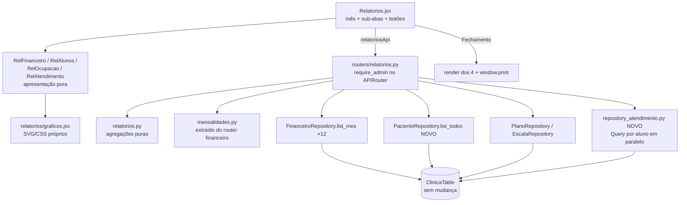

# Relatórios Design

**Spec**: `.specs/features/relatorios/spec.md` · **Decisões**: `context.md` (D1–D6)
**Status**: Draft

---

## Architecture Overview

O back **agrega**: 4 endpoints GET, um por grupo, cada um devolvendo números prontos. O front
**desenha**: 4 componentes de apresentação que recebem os dados por prop, sem buscar nada.
Sendo puros, os mesmos componentes servem a tela, o PDF de um relatório e o fechamento do mês
(D6). Isso garante que o fechamento tenha os mesmos números da tela (REL-17 AC3).

A agregação fica em **funções puras** (`relatorios.py`), sem I/O. Os testes rodam sem moto e cobrem
as regras (meses, fuso, saídas, rankings). Os routers só buscam os dados nos repositórios
existentes e chamam essas funções.



**Infraestrutura: nada muda.** As rotas `GET /relatorios/*` já passam pelo evento `ProxyGet`
(`/{proxy+}`) com o JWT Authorizer. Não há tabela, GSI ou dependência nova
(`concurrent.futures` é stdlib), então o deploy é só a Lambda e vale o atalho sem Docker
([[sam-deploy-sem-docker]]).

---

## Code Reuse Analysis

| Componente | Local | Uso |
|---|---|---|
| `FinanceiroRepository.list_mes(mes)` | `repository_financeiro.py` | Caixa do mês e dos 12 meses. Já pagina e filtra `ativo` |
| `FinanceiroRepository.list_por_competencia` | idem | Pagamentos das mensalidades do mês |
| Lógica de `mensalidades_do_mes` | `routers/financeiro.py` | **Extraída** para `mensalidades.py::calcular_mensalidades`; os dois routers chamam a mesma função (REL-06 "bate 100%") |
| `_status`, `STATUS_*` | `routers/financeiro.py`, `schemas_plano.py` | Vão junto para `mensalidades.py` |
| `valida_mes` | `schemas_financeiro.py` | Valida o `?mes=` (400 legível, mesmo padrão de `_validar_mes`) |
| `PlanoRepository.list_all` | `repository_plano.py` | Carteira de planos |
| `EscalaRepository.list_all` | `repository_escala.py` | Ocupação |
| `PacienteRepository.list_ativos` | `repository.py` | Base de `list_todos` (mesmo GSI1, sem o filtro `ativo`) |
| `require_admin`, `get_clinic_id` | `deps.py` | Barra não-admin (403) no `APIRouter` (D3) |
| `mesAnterior/mesSeguinte/mesAtual/formatMesBR/centavosParaBR/labelForma/formatDataBR` | `frontend/src/utils/format.js` | Navegação de mês, R$ e datas |
| `DIAS`, `HORARIOS` | `frontend/src/components/Escala.jsx` (export) | Eixos do mapa de calor, na mesma ordem da grade |
| Navegação "‹ Mês/Ano ›" | `Financeiro.jsx` | Mesmo visual. Em Relatórios o "›" fica desabilitado no mês corrente (REL-02) |
| Padrão de aba só admin | `App.jsx` (`isAdmin && …`) | Aba Relatórios ao lado de Financeiro |

---

## Components (back)

### `src/app/mensalidades.py` (extração, sem mudança de comportamento)
- `calcular_mensalidades(alunos, planos, lancamentos_competencia, escala) -> dict`: devolve exatamente o corpo atual de `GET /financeiro/mensalidades` (totais + linhas). O router financeiro passa a chamar a função, e os testes existentes de `test_mensalidades.py` provam que nada mudou.

### `PacienteRepository.list_todos()` (novo método em `repository.py`)
- Query no GSI1 **sem** filtro de `ativo`, **paginada** (`LastEvaluatedKey`). Devolve ativos e removidos, porque o relatório de alunos precisa das saídas.

### `src/app/repository_atendimento.py` (novo)
- `list_sessoes_periodo(clinic_id, paciente_ids, de, ate, table_name=None) -> list[dict]`: para cada aluno, faz uma Query `PK=CLINIC#<c>#CLIENT#<p>`, `SK begins_with SESSION#`, com `FilterExpression ativo = true AND data BETWEEN de AND ate`, paginada. As Queries rodam em **paralelo** (`ThreadPoolExecutor`, `max_workers=16`) com um **client** boto3 de baixo nível compartilhado, que é thread-safe (o `resource` não é), e `TypeDeserializer`. Cada item volta com `pacienteId`.
- Custo: N Queries pequenas (N = alunos, ativos e removidos). Com 300 alunos e 16 workers dá ~19 rodadas de ~30 ms, **~0,6 s** (REL-19 pede < 5 s). Sem GSI novo: alterar a tabela de produção foi descartado em `context.md`.

### `src/app/relatorios.py` (novo, funções puras)
Convenções: valores em **centavos inteiros**. O mês é `AAAA-MM`. Timestamps (`criadoEm`/`atualizadoEm`, ISO UTC) passam por `mes_local(ts)`, que converte para **UTC−3** fixo (o Brasil não tem horário de verão desde 2019) antes de pegar o mês. Assim um aluno cadastrado às 22h do dia 31 conta no mês certo. `meses_ate(mes, n=12)` lista os 12 meses que terminam em `mes`.

- `resumo_caixa(lancamentos) -> {entradas, saidas, saldo}`: a mesma conta de `caixa_do_mes`.
- `receita_por_forma(lancamentos) -> [{forma, valorCentavos, pct}]`: só entradas, ordenado por valor. `cartao` vira `"cartao"` (o front rotula "Cartão (antigo)") e `None` vira `"nao_informado"`.
- `resumo_mensalidades(mensalidades) -> {previsto, recebido, emAberto, porStatus:{pago,parcial,aberto,isento,sem_plano}}`.
- `indicadores_alunos(perfis, mes) -> {ativosFimMes, novos, saidas, novosLista}` e `evolucao_alunos(perfis, meses)`. Regras: novo = `mes_local(criadoEm) == mes`. Saída = perfil inativo com `mes_local(atualizadoEm) == mes`. Ativo no fim de M = `mes_local(criadoEm) <= M` e (ativo, ou saída `> M`).
- `carteira_planos(planos, alunos_ativos) -> {totalMensal, ticketMedio, comPlano, isentos, semPlano, porFrequencia:[{frequencia, alunos}]}`. Considera só os planos de alunos **ativos**. O ticket médio ignora os isentos (valor 0), para que bolsistas não puxem a média para baixo.
- `ocupacao(matriculas, alunos_ativos) -> {celulas:[{dia,hora,alunos}], matriculas, alunosDistintos, mediaPorHorarioOcupado, top5, foraDaEscala:[{id,nome}]}`. Ignora matrículas órfãs (aluno removido), como o `GET /escala` já faz.
- `atendimento(sessoes, perfis, mes, meses) -> {total, evolucao, porProfissional, porAluno, aparelhos, treinos}`. O profissional é agrupado por `profissionalId` quando existe; o rótulo é o nome do snapshot mais recente, e sem profissional vira `"Sem profissional"`. O aparelho conta **1 por aula** em que aparece (pelo nome do snapshot). O treino conta 1 por aula e por aparelho em que aparece. Os rankings são ordenados por quantidade desc e depois por nome.

### `src/app/schemas_relatorio.py` (novo)
- `RelFinanceiroOut`, `RelAlunosOut`, `RelOcupacaoOut`, `RelAtendimentoOut`: modelos de saída que fixam o contrato com o front.

### `src/app/routers/relatorios.py` (novo)
- `APIRouter(prefix="/relatorios", dependencies=[Depends(require_admin)])`.
- `GET /relatorios/financeiro?mes=`: 12 × `list_mes` + mensalidades do mês (4 Queries) → `resumo_caixa` (mês), evolução, `receita_por_forma`, `resumo_mensalidades`.
- `GET /relatorios/alunos?mes=`: `list_todos` + `PlanoRepository.list_all`.
- `GET /relatorios/ocupacao`: `EscalaRepository.list_all` + `list_ativos`. Sem `mes` (D4: a grade não tem histórico).
- `GET /relatorios/atendimento?mes=`: `list_todos` → `list_sessoes_periodo(ids, 1º dia do 1º mês, último dia de mes)`.
- `?mes=` ausente = mês corrente em UTC−3. Inválido ou **futuro** = **400**.

---

## Components (front)

| Arquivo | Papel |
|---|---|
| `api.js` → `relatoriosApi` | `financeiro(mes)`, `alunos(mes)`, `ocupacao()`, `atendimento(mes)` |
| `components/relatorios/graficos.jsx` | `Kpi` (número grande + rótulo), `BarrasMensais` (SVG, 12 meses, 1–3 séries, valor no hover/legenda, rótulos de mês abreviados), `Ranking` (barras horizontais em CSS com o número escrito), `MapaCalor` (tabela dia × hora, intensidade da cor + número na célula). Sem biblioteca nova. Antes de escrever, carregar a skill **dataviz** |
| `components/relatorios/RelFinanceiro.jsx`, `RelAlunos.jsx`, `RelOcupacao.jsx`, `RelAtendimento.jsx` | Apresentação pura: `({dados, mes})`. Inclui o estado vazio ("Nenhum lançamento neste mês", "A clínica ainda não usa a Escala") e as notas da spec (grade atual, planos de hoje) |
| `components/relatorios/CabecalhoImpressao.jsx` | Nome da clínica, nome do relatório, mês e "Emitido em dd/mm/aaaa hh:mm". `display:none` na tela, visível no print |
| `components/Relatorios.jsx` | Container: mês (padrão = atual, "›" desabilitado no atual), sub-abas, busca do grupo ativo, **Imprimir / PDF** (`window.print()`) e **Fechamento do mês** |
| `App.jsx` | Aba "Relatórios" só para admin, depois de Financeiro |
| `App.css` | Seção `rel-*` + bloco `@media print` |

### Impressão / PDF (REL-16, REL-17)
- `@page { size: A4 portrait; margin: 12mm; }`. No print, `.topbar`, `.tabs`, `.no-print` e as abas/botões de Relatórios ficam ocultos, e `CabecalhoImpressao` aparece.
- `tr, .kpi, .grafico { break-inside: avoid; }` e `thead { display: table-header-group; }` (o cabeçalho da tabela repete em cada página).
- Mapa de calor e barras com `print-color-adjust: exact`. Cada valor também aparece **escrito**, então o gráfico continua legível em P&B (REL-16 AC4).
- **Fechamento**: ao clicar, o front busca os 4 grupos com `Promise.allSettled`. Se algum falhar, mostra qual falhou e **não imprime** (REL-17 AC4). Se der tudo certo, monta `<div className="rel-fechamento">` com capa e os 4 componentes (cada `.rel-secao` com `break-before: page`), marca o container da tela com `no-print`, chama `window.print()` no próximo frame e desmonta no evento `afterprint`.
- Por que impressão do navegador e não PDF no back: não precisa de lib nova no front nem na Lambda (onde uma lib nova quebraria o deploy sem Docker), e o texto sai selecionável. O ponto fraco é que a margem e o cabeçalho do navegador dependem da configuração do usuário. A tela ganha uma dica "No destino, escolha **Salvar como PDF**".

---

## Data Models (respostas)

```ts
RelFinanceiro { mes; caixa:{entradasCentavos,saidasCentavos,saldoCentavos};
  evolucao:[{mes,entradasCentavos,saidasCentavos,saldoCentavos}]  // 12, cronológico
  porForma:[{forma,valorCentavos,pct}];
  mensalidades:{previstoCentavos,recebidoCentavos,emAbertoCentavos,porStatus:{pago,parcial,aberto,isento,sem_plano}} }
RelAlunos { mes; ativosFimMes; novos; saidas; evolucao:[{mes,ativos,novos,saidas}];
  carteira:{totalMensalCentavos,ticketMedioCentavos,comPlano,isentos,semPlano,porFrequencia:[{frequencia,alunos}]};
  novosLista:[{id,nome,criadoEm}] }
RelOcupacao { celulas:[{dia,hora,alunos}]; matriculas; alunosDistintos; mediaPorHorarioOcupado;
  top5:[{dia,hora,alunos}]; foraDaEscala:[{id,nome}] }
RelAtendimento { mes; total; evolucao:[{mes,aulas}]; porProfissional:[{profissionalId?,nome,aulas}];
  porAluno:[{pacienteId,nome,aulas}]; aparelhos:[{nome,aulas}]; treinos:[{nome,aulas}] }
```

---

## Error Handling Strategy

| Cenário | Tratamento | O que o usuário vê |
|---|---|---|
| Membro chama `/relatorios/*` | 403 no `require_admin` | Aba nem aparece |
| `?mes=` inválido ou futuro | 400 com mensagem | O seletor não deixa chegar lá |
| Clínica ou mês sem dados | 200 com zeros e listas vazias | Mensagens de "sem dados" |
| Falha de rede num grupo | Erro no container do grupo | "Não foi possível carregar…" + Tentar de novo |
| Falha num grupo do fechamento | `allSettled` → aborta | "O fechamento não foi gerado: falhou Atendimento" |
| Token expirado | Fluxo existente (`SessaoExpirada`) | Igual às outras abas |

---

## Tech Decisions

| Decisão | Por quê |
|---|---|
| Agregação no back, funções puras | O front não soma milhares de itens; os testes ficam sem moto; Fechamento = Tela por construção |
| Query por aluno em paralelo, sem GSI | Não altera a tabela de produção; ~0,6 s com 300 alunos. Revisitar se alguma clínica passar de ~2.000 alunos |
| Client boto3 (não resource) nas threads | O client é thread-safe; o resource não é |
| UTC−3 fixo para "mês local" | Lambda sem depender de tzdata; o Brasil não tem horário de verão |
| Extrair `calcular_mensalidades` | Uma fonte de verdade para os números de mensalidades (REL-06) |
| Gráficos próprios (SVG/CSS) | O front só depende de React; o bundle continua leve; controle total da impressão |
| `window.print()` + `@media print` | Zero dependência; atende o PDF por relatório e o fechamento |
